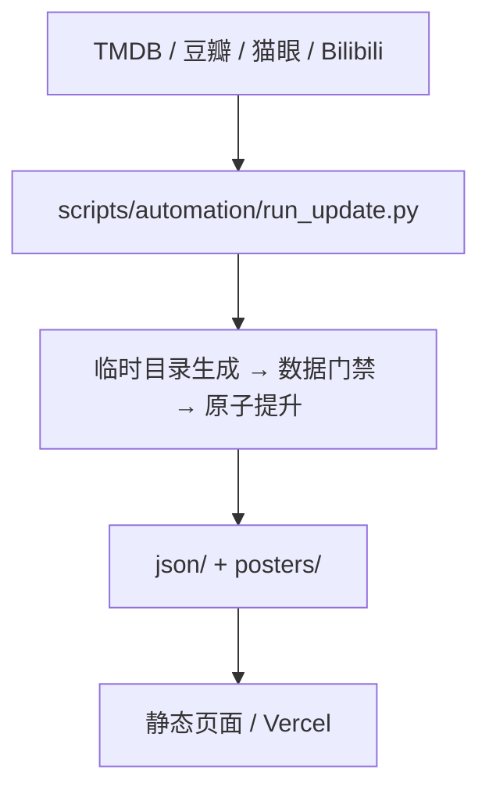

<p align="center">
  
</p>

<h1 align="center">CineScope</h1>

<p align="center">从近期新作到豆瓣 Top250，在一张片单里找下一部想看的影视。</p>

<p align="center">
  <a href="https://movie.lrwei91.cn/">在线浏览</a> ·
  <a href="#本地启动">本地启动</a> ·
  <a href="https://github.com/lrwei91/CineScope/issues">反馈建议</a>
</p>

<p align="center">
  <a href="LICENSE"></a>
</p>


CineScope（站内名称「鲤鱼环球片单」）是面向中文用户的影视片单站点，覆盖国产剧、院线电影、综艺、韩剧、日剧、美剧和豆瓣 Top250。站点没有后端：数据由脚本预先写成 JSON，页面直接读取，打开就能浏览。界面用白纸、黑墨和黄色强调，优先展示真实海报和作品信息。

## 找片、了解、留存

- **找片**：选择分类后，按名称、评分、类型、年份或形式筛选；可用的条件随分类变化。
- **了解作品**：按时间浏览片单，打开详情看简介、评分、连载状态和可用的预告片；票房和剧集热度来自猫眼。
- **查看收藏**：关联已同步的豆瓣想看、在看、看过状态，手机「我的」页提供收藏列表和统计。
- **分享与安装**：生成作品分享图，也可以添加到主屏，或在支持的浏览器里安装成独立窗口应用。

手机端以「发现、我的、关于、搜索」组织入口，详情用全屏阅读布局；桌面端保留分类导航、筛选和月份分组。上面的截图来自本地页面，展示的是仓库里已有的数据，不代表线上实时状态。

## 本地启动

只浏览现有片单的话，用 Python 起一个静态 HTTP 服务就够了，不需要 API Key、不需要 npm 安装，也不用更新数据：

```bash
git clone https://github.com/lrwei91/CineScope.git
cd CineScope
python3 -m http.server 8000
```

打开 [localhost:8000](http://localhost:8000)。仓库里已经包含页面需要的 JSON 和海报。

开发和数据维护另外需要 **Node.js 18+、Python 3.11+**（CI 使用 Node.js 22、Python 3.11），并安装 Python 依赖：

```bash
python3 -m pip install -r scripts/automation/requirements.txt
```

完整更新需要 `TMDB_API_KEY`，模板见 `.env.example`。runner 只读取进程环境变量，不会自动加载 `.env`，所以运行更新之前要在本地安全地配置并导出这个变量。豆瓣缓存的补充依赖真实浏览器登录态，部分任务还依赖本地网络环境，详见 [数据更新指南](docs/DATA_UPDATE_GUIDE.md)。

## 数据如何到达页面

项目用原生 ES Modules，没有后端，也没有运行时 npm 依赖。数据先生成、验证，再由静态页面读取：



首屏先加载当前分类的 `latest.json`，后台再用 `complete.json` 补全；切换分类时按需加载并缓存。豆瓣收藏状态并行请求，失败不会阻塞片单。院线电影优先使用完整数据。

数据依赖上游可用性和更新任务，评分、预告片或状态都可能缺失。猫眼接口失败时，有效缓存会保留原来的更新时间并标记 `stale_upstream`；缓存不等于实时结果。

## 更新片单

所有数据更新都走统一入口：先试运行，确认后再决定是否写入本地：

```bash
# 临时生成与验证，不提升到正式 JSON
python3 scripts/automation/run_update.py --task tv-status --dry-run

# 验证成功后更新本地 JSON，不提交、不推送
python3 scripts/automation/run_update.py --task tv-status
```

| 任务 | 更新内容 |
| --- | --- |
| `full` | 全分类、猫眼、豆瓣状态与 Top250 |
| `tv-status` | 国产剧集数与连载状态 |
| `douban-cache` | 通过浏览器登录态补充豆瓣详情缓存 |
| `trailers` | 国产影视 Bilibili 预告片 |

GitHub Actions 里的 `full` 配置为北京时间每天 22:00。需要本地登录态或特定网络环境的任务由 Hermes 调度；职责划分、调度约定和环境配置见 [数据更新指南](docs/DATA_UPDATE_GUIDE.md#2-任务职责)，本仓库负责业务逻辑和验证协议。

`--publish` 会提交并推送生成的数据，用之前要确认确实要发布。`full` 发布要求工作区干净；`tv-status`、`douban-cache`、`trailers` 可以保留非发布路径上的编辑，但 `json/`、`posters/` 必须干净。远端同步不会覆盖本地改动。

任务用进程锁防止本地并发，并校验结构、重复 ID、latest/complete 一致性、数量回退和海报路径。数据缩减超过 20% 时，要先确认上游和业务意图，才使用 `--allow-large-drop`。运行结果记录在 [`json/build_report.json`](json/build_report.json)；v2 报告保留分任务状态和最近一次完整构建结果，局部任务不会清空其他分类的报告。

## 开发与部署

```bash
npm test              # Node + Python 单测（需要上面的 Python 依赖）
npm run check:syntax  # JS/MJS 语法检查
npm run check:data    # JSON 数据门禁
npm run check         # 全部检查
npm run build:site    # 生成 .site/ 静态部署产物
```

PR 检查会执行代码、数据和构建验证；每日更新验证后推送 `main`，Vercel 通过仓库集成构建并发布 `.site/`。部署只包含运行所需的白名单文件，不发布脚本、测试和文档；不要直接编辑 `.site/`。

- `index.html`、`app.js`、`js/modules/`：页面入口、交互与数据渲染。
- `share.js`、`share.css`：作品分享图。
- `json/`、`posters/`：生成数据与本地海报。
- `assets/`、`manifest.webmanifest`：插画、安装图标与安装清单。
- `ios/`：原生 iOS 客户端（SwiftUI + 预告片 WebView）。
- `scripts/automation/`：统一更新入口与本地数据任务。
- `scripts/catalog/`、`scripts/lib/`：分类配置、数据源与转换逻辑。
- `tests/`、`.github/workflows/`：回归测试与 CI。

海报目前以普通 Git 二进制文件跟踪，没有启用 Git LFS。安装图标和标签页 favicon 分开维护；换过图标后可能需要移除旧安装再重新添加，详见 [项目设计说明](docs/DESIGN_BRIEF.md#平台图标与安装元数据)。

## iOS 客户端

`ios/` 是原生 SwiftUI 客户端，发现、筛选、详情、我的和搜索全部原生实现，只有 Bilibili 预告片交给 WKWebView。数据直接读线上的 `json/`，断网时回退到最近一次成功副本。

```sh
open ios/CineScope.xcodeproj   # 选择签名团队后 ⌘R
```

首次真机安装需要开启开发者模式并信任证书；免费签名 7 天有效。构建命令、深链和验证状态见 [iOS 说明](ios/README.md)。

## 维护文档

- [数据更新指南](docs/DATA_UPDATE_GUIDE.md)：环境变量、任务职责、发布与故障处理。
- [设计与验收说明](docs/DESIGN_BRIEF.md)：视觉、手机交互、图标与验收边界。
- [iOS 客户端](ios/README.md)：构建、签名、架构与验证状态。
- [项目上下文](CONTEXT.md)：架构速记与维护入口。

## 数据来源与许可

- [TMDB](https://www.themoviedb.org/)：影视基础信息与海报。
- [豆瓣](https://movie.douban.com/)：评分、Top250 与收藏状态。
- 猫眼 60s：票房与剧集热度。
- [Bilibili](https://www.bilibili.com/)：预告片。

[MIT](LICENSE) © 2026 lrwei91。许可覆盖仓库代码与配置；`json/`、`posters/` 及界面截图中的第三方影视元数据和素材，其版权与使用条件归各自权利人所有。
